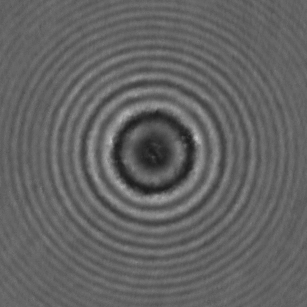

# CATCH

[](https://github.com/laltman2/CATCH/actions/workflows/test.yml)
[](LICENSE)

**C**haracterizing **A**nd **T**racking **C**olloids **H**olographically

Machine-learning models that find colloidal particles in in-line
holographic microscopy images and estimate each particle's position,
radius and refractive index, well enough for a fit of the Lorenz-Mie
theory to lock on.

## What CATCH does
1. A **Localizer**, a heatmap detector after CenterNet, finds the center of
   each hologram in a normalized image, in crowded frames and at the edges.
2. An **Estimator** measures the radial profile of each hologram; a network
   proposes 64 candidates for the axial position `z_p`, radius `a_p` and
   refractive index `n_p`; each candidate is checked against the profile
   with the Lorenz-Mie theory, on the GPU; the best become the starts of a
   fit.
3. Optionally, a **fit** from every start (with
   [pylorenzmie](https://github.com/davidgrier/pylorenzmie)) and a rule that
   chooses among near-degenerate solutions and reports how ambiguous the
   result is.

The networks are trained on synthetic holograms and serve any microscope
whose pixel, in wavelengths of the medium, is 1 to 2.5 times the reference
pixel (0.048 µm at 0.447 µm in water).  The estimates take about 7 to 11 ms
per particle on an Apple M-series GPU.



## Installation
CATCH requires Python 3.11 or later and PyTorch. Install it from a checkout:

```sh
git clone https://github.com/laltman2/CATCH.git
pip install ./CATCH
pip install "./CATCH[fit]"      # for the fits (pylorenzmie)
```

Other extras: `train` (pylorenzmie, for training and the evaluation
harness) and `dev` (pytest, coverage and ruff).

## Usage
The models expect a *normalized* hologram: the recorded image divided by
the background (a background of 1, or of 100 as in CATCH 2). Lengths are in
micrometers, except coordinates in the image and `z_p`, which are in pixels.

```python
import cv2
from CATCH import CATCHapp

image = cv2.imread('docs/images/test_image_large.png', cv2.IMREAD_GRAYSCALE)

catch = CATCHapp(instrument=dict(wavelength=0.447, magnification=0.048,
                                 n_m=1.34))
results = catch(image)                    # a list of images works too
fitted = catch(image, fit=True)           # also fit, and choose
polystyrene = catch(image, fit=True, nrange=(1.55, 1.70))   # a prior
```

`results` is a `pandas.DataFrame` with one row per particle:

| column | meaning |
|---|---|
| `label`, `confidence` | `'hologram'`, and the score of the detector |
| `x_p`, `y_p` | center of the hologram in the image, in pixels |
| `bbox` | `((x_0, y_0), w, h)`: twice the radius of the 20th fringe |
| `edge` | `True` if the box crosses an edge of the image |
| `z_p`, `a_p`, `n_p` | the best start: axial position, radius and index |
| `framenum` | index of the image in the list that was analyzed |
| `misfit`, `starts` | misfit of the best start; all the starts, best first |

With `fit=True`: the chosen fit (`x_fit` ... `n_fit`, `redchi`), a `flag`,
and the ambiguity (`nsolutions`, `a_spread`, `n_spread`, `z_spread`, and the
best other solution `alt_a`, `alt_n`, `alt_redchi`).  See the
[documentation](docs/quickstart.rst).

## Training
Most instruments need no training. For the others, or to fine-tune:

```sh
python -m CATCH.training.localizer runs/localizer --steps 20000
python -m CATCH.training.estimator runs/estimator --steps 40000
```

and `CATCHapp(lmodel='runs/localizer', emodel='runs/estimator')`; see
[docs/training.rst](docs/training.rst).

## Development
```sh
python3 -m venv ~/python/venvs/catch      # keep the venv outside the checkout
~/python/venvs/catch/bin/pip install -e "./CATCH[dev]"
~/python/venvs/catch/bin/python -m pytest --cov
ruff check .
```

The tests use models with random weights, not the trained ones. See
[CONTRIBUTING.md](CONTRIBUTING.md) for the style rules and
[CHANGELOG.md](CHANGELOG.md) for what has changed.

## Acknowledgments
This work was primarily supported by the SBIR program of the National
Institutes of Health under Award Number R44TR001590. The Titan Xp and Titan
RTX GPUs used for this work were provided by GPU Grants from NVIDIA.

## License
CATCH is released under the [MIT License](LICENSE).
